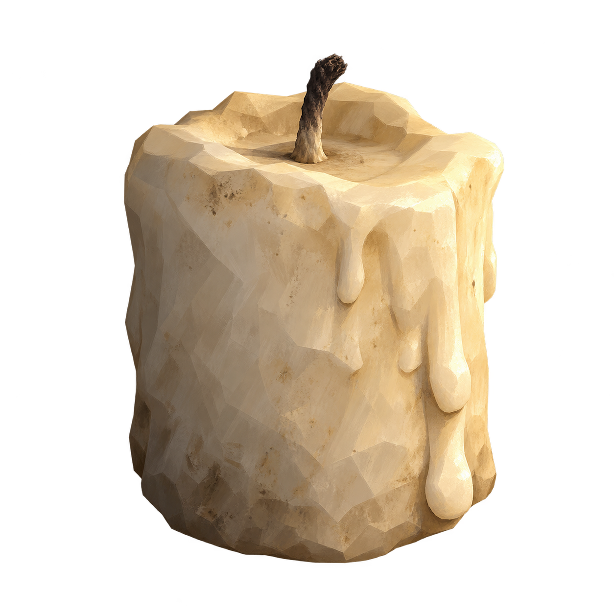
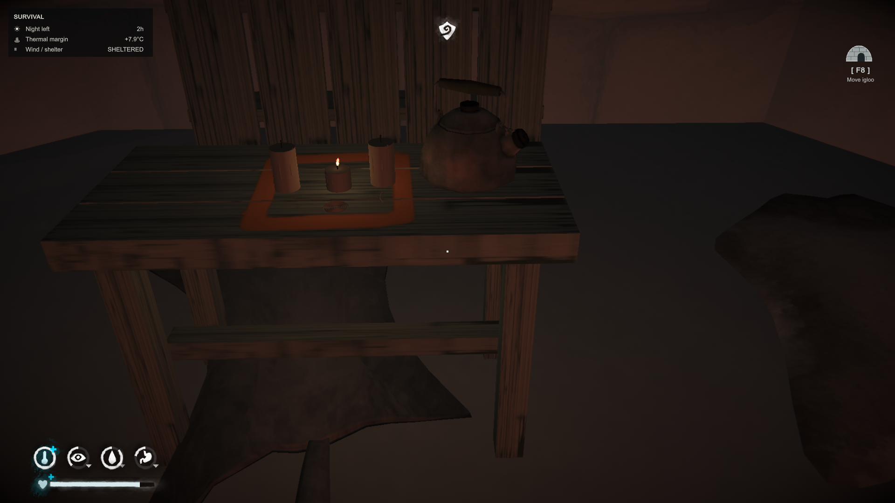

# Burebista Candle Recipes

**The Long Dark · v0.3.2 · English / Español**

## English
Craft your own candles and wicks for a nomadic camp. Includes functional candle light, wick preparation and cutting, with in-game English/Spanish text.

**Install:** download `BurebistaCandleRecipes.dll` from [Releases](../../releases/latest), close the game and place it in `TheLongDark/Mods`. Requires MelonLoader. Keep only one version of the DLL. Use the in-game crafting recipes and their displayed requirements. Do not combine it with the retired Burebista Nomad Camp addon.

## Español
Fabrica velas y mechas para tu campamento nómada. Incluye iluminación funcional, preparación y corte de mechas y textos en español/inglés.

**Instalar:** descarga `BurebistaCandleRecipes.dll` desde [Releases](../../releases/latest), cierra el juego y colócala en `TheLongDark/Mods`. Requiere MelonLoader. Conserva una sola versión. Usa las recetas y requisitos indicados dentro del juego. No combinar con el antiguo addon Burebista Nomad Camp.

## Images / Imágenes

## Source / Código
.NET 6. Set `GameDir` to your local The Long Dark folder and build `Candles.csproj`. Game and MelonLoader DLLs are references only and are not distributed here. Prepared against the installed TLD 2.59 environment.
